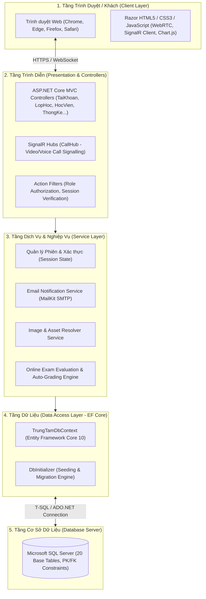
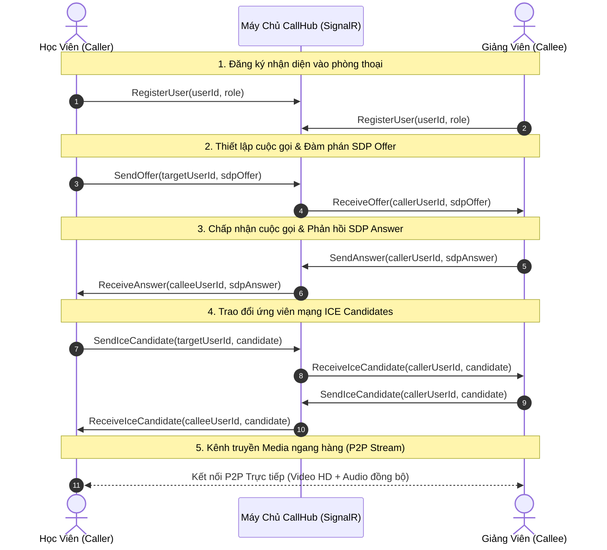
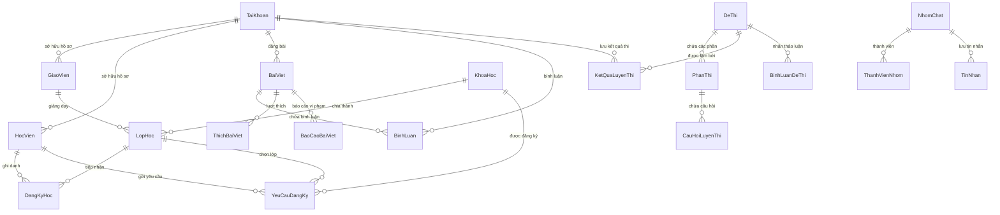
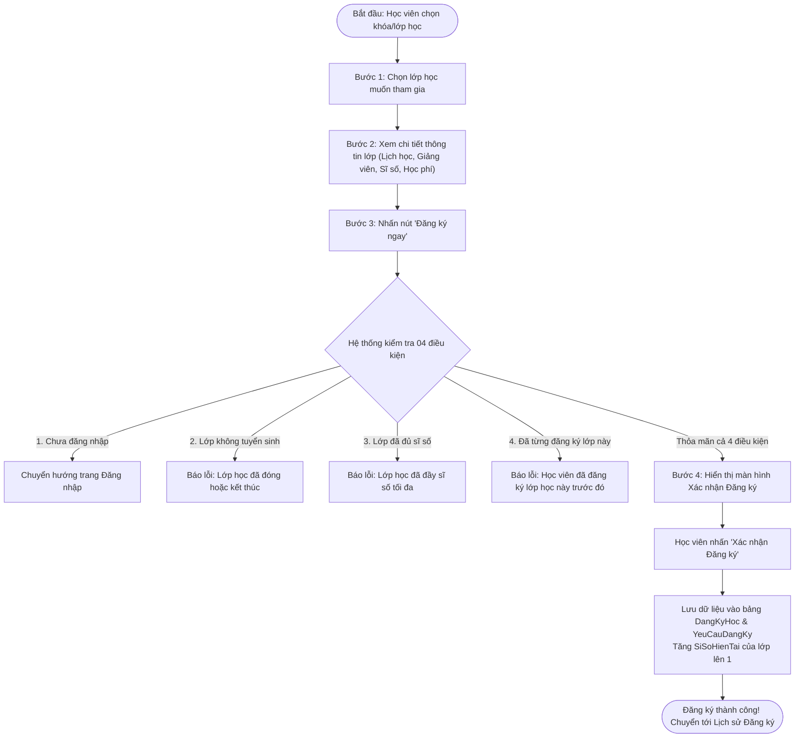

# 📐 TÀI LIỆU THIẾT KẾ KIẾN TRÚC & KỸ THUẬT HỆ THỐNG (DESIGN SPECIFICATION)

> **Dự án**: Hệ Thống Quản Lý & Học Tập Trực Tuyến Trung Tâm Ngoại Ngữ (EduCenter)  
> **Phiên bản tài liệu**: 2.0  
> **Ngôn ngữ & Nền tảng**: C# 14, .NET 10 (ASP.NET Core MVC), Entity Framework Core 10, SQL Server, SignalR, WebRTC  

---

## 📑 MỤC LỤC
1. [Tổng Quan Kiến Trúc Hệ Thống (System Architecture)](#1-tổng-quan-kiến-trúc-hệ-thống)
2. [Kiến Trúc Giao Tiếp Thời Gian Thực & WebRTC](#2-kiến-trúc-giao-tiếp-thời-gian-thực--webrtc)
3. [Thiết Kế Cơ Sở Dữ Liệu & ERD (Database Design)](#3-thiết-kế-cơ-sở-dữ-liệu--erd)
4. [Thiết Kế Quy Trình Nghiệp Vụ Cốt Lõi (Business Workflows)](#4-thiết-kế-quy-trình-nghiệp-vụ-cốt-lõi)
5. [Hệ Thống Thiết Kế Giao Diện (UI/UX Design System)](#5-hệ-thống-thiết-kế-giao-diện-uiux-design-system)
6. [Thiết Kế Bảo Mật & Tối Ưu Hóa (Security & Performance)](#6-thiết-kế-bảo-mật--tối-ưu-hóa)

---

## 1. TỔNG QUAN KIẾN TRÚC HỆ THỐNG

Hệ thống được thiết kế theo mô hình **Kiến trúc Phân tầng (Layered Architecture)** kết hợp mẫu thiết kế **Model-View-Controller (MVC)** chuẩn của ASP.NET Core, đảm bảo tính phân tách trách nhiệm (Separation of Concerns), dễ bảo trì và dễ mở rộng.



### Các Tầng Thành Phần:
1. **Presentation Layer (Tầng hiển thị & điều hướng)**:
   - **Controllers**: Đón nhận HTTP Request, xử lý xác thực/phân quyền, điều phối dữ liệu nghiệp vụ và chuyển giao Model tới Razor Views.
   - **Razor Views**: Render giao diện HTML hướng máy chủ (Server-side Rendering) kết hợp JavaScript cho các tương tác phía client (DataTables, Chart.js, Modal, Audio player).
   - **SignalR Hubs**: Tiếp nhận kết nối WebSocket phục vụ truyền thông thời gian thực và trao đổi tín hiệu WebRTC.
2. **Business / Services Layer (Tầng xử lý logic & dịch vụ)**:
   - Kiểm tra các ràng buộc nghiệp vụ (kiểm tra sĩ số lớp, trạng thái tuyển sinh, tránh trùng lặp đăng ký).
   - Tính toán và chấm điểm đề thi trắc nghiệm tự động dựa trên đáp án chuẩn và thời gian nộp bài.
   - Dịch vụ gửi email thông báo xác nhận và quản lý thư viện hình ảnh đa ngôn ngữ.
3. **Data Access Layer (Tầng truy xuất dữ liệu)**:
   - Quản trị kết nối qua `TrungTamDbContext`, sử dụng LINQ để biên dịch truy vấn sang SQL an toàn, tự động quản lý transaction và quan hệ giữa các bảng.

---

## 2. KIẾN TRÚC GIAO TIẾP THỜI GIAN THỰC & WEBRTC

Phân hệ Video Call & Đàm thoại trực tuyến sử dụng mô hình kết hợp giữa **ASP.NET Core SignalR** làm máy chủ truyền tin báo hiệu (Signalling Server) và **WebRTC** để thiết lập luồng truyền phát âm thanh/hình ảnh ngang hàng (Peer-to-Peer Media Stream).



### Điểm Kỹ Thuật Đáng Chú Ý:
- **Signalling Hub**: Triển khai tại `CallHub.cs`, đóng vai trò định tuyến các thông điệp `Offer`, `Answer` và `IceCandidate` giữa các client mà không lưu nội dung video trên máy chủ, tối ưu băng thông tối đa.
- **Dự phòng STUN**: Sử dụng máy chủ công cộng của Google (`stun:stun.l.google.com:19302`) để giải quyết bài toán NAT Traversal giữa các thiết bị khác mạng.
- **Đồng bộ hóa Canvas/Video**: Xử lý `MediaStream` sạch, chống hiện tượng màn hình đen khi chuyển đổi camera hoặc khi không có webcam vật lý bằng luồng giả lập Canvas động.

---

## 3. THIẾT KẾ CƠ SỞ DỮ LIỆU & ERD

Cơ sở dữ liệu `TrungTamNgoaiNguDb` bao gồm **20 bảng thực thể** được phân bổ chặt chẽ theo các module:



### Danh Sách Chi Tiết 20 Bảng Phân Theo Module:

#### 1. Module 1: Tài Khoản & Khóa Học (VŨ TRƯỜNG AN)
- **`TaiKhoan`**:
  - `MaTaiKhoan` (INT, PK, Identity): Mã định danh tài khoản.
  - `TenDangNhap` (NVARCHAR(50), Unique): Tên tài khoản đăng nhập.
  - `MatKhau` (NVARCHAR(255)): Mật khẩu bảo mật.
  - `HoTen` (NVARCHAR(100)), `Email` (NVARCHAR(100)), `VaiTro` (NVARCHAR(20) - 'Admin'/'GiaoVien'/'HocVien').
  - `TrangThai` (NVARCHAR(20) - 'HoatDong'/'BiKhoa').
- **`KhoaHoc`**:
  - `MaKhoaHoc` (INT, PK, Identity): Mã khóa học.
  - `TenKhoaHoc` (NVARCHAR(150)), `NgoaiNgu` (NVARCHAR(50) - 'TiengAnh'/'TiengHan'/'TiengTrung'/'TiengNhat').
  - `CapDo` (NVARCHAR(50)), `HocPhi` (DECIMAL(18,2)), `SoBuoi` (INT), `MoTa` (NVARCHAR(MAX)), `TrangThai` (NVARCHAR(50)).

#### 2. Module 2: Lớp Học & Giảng Viên (TRẦN TRỌNG TRÁNG)
- **`LopHoc`**:
  - `MaLopHoc` (INT, PK, Identity): Mã lớp học.
  - `TenLop` (NVARCHAR(100)): Tên lớp học.
  - `MaKhoaHoc` (INT, FK $\rightarrow$ KhoaHoc): Thuộc khóa học nào.
  - `MaGiaoVien` (INT, FK $\rightarrow$ GiaoVien, Nullable): Giảng viên phụ trách đứng lớp.
  - `NgayKhaiGiang` (DATETIME2), `LichHoc` (NVARCHAR(100)), `PhongHoc` (NVARCHAR(50)).
  - `SiSoToiDa` (INT), `SiSoHienTai` (INT), `HocPhi` (DECIMAL(18,2)), `TrangThai` (NVARCHAR(50)).
- **`GiaoVien`**:
  - `MaGiaoVien` (INT, PK, Identity), `MaTaiKhoan` (INT, FK $\rightarrow$ TaiKhoan).
  - `HoTen` (NVARCHAR(100)), `ChuyenMon` (NVARCHAR(50)), `HocVi` (NVARCHAR(100)), `Email` (NVARCHAR(100)), `SoDienThoai` (NVARCHAR(20)).

#### 3. Module 3: Học Viên & Đăng Ký Lớp Học (PHẠM THANH TÙNG)
- **`HocVien`**:
  - `MaHocVien` (INT, PK, Identity), `MaTaiKhoan` (INT, FK $\rightarrow$ TaiKhoan, Nullable).
  - `HoTen` (NVARCHAR(100)), `NgaySinh` (DATETIME2), `GioiTinh` (NVARCHAR(10)).
  - `SoDienThoai` (NVARCHAR(20)), `Email` (NVARCHAR(100)), `DiaChi` (NVARCHAR(255) - *Chuẩn mục 4.14*).
- **`DangKyHoc`**:
  - `MaDangKy` (INT, PK, Identity), `MaHocVien` (INT, FK $\rightarrow$ HocVien), `MaLopHoc` (INT, FK $\rightarrow$ LopHoc).
  - `NgayDangKy` (DATETIME2), `TrangThaiThanhToan` (NVARCHAR(50)), `SoTienDaDong` (DECIMAL(18,2)).

#### 4. Module 4: Quản Lý Đăng Ký & Dashboard Thống Kê (KHIẾU QUỐC TOẢN)
- **`YeuCauDangKy`**:
  - `MaYeuCau` (INT, PK, Identity), `MaKhoaHoc` (INT, FK $\rightarrow$ KhoaHoc), `MaLopHoc` (INT, FK $\rightarrow$ LopHoc, Nullable).
  - `HoTen` (NVARCHAR(100)), `Email` (NVARCHAR(100)), `SoDienThoai` (NVARCHAR(20)).
  - `TrangThai` (NVARCHAR(50) - 'ChoDuyet'/'DaDuyet'/'TuChoi'), `NgayTao` (DATETIME2), `HocPhi` (DECIMAL(18,2)).
- **`CauHinhHeThong`**:
  - `Khoa` (NVARCHAR(100), PK), `GiaTri` (NVARCHAR(500)), `MoTa` (NVARCHAR(255)), `NgayCapNhat` (DATETIME2).

#### 5. Module Mở Rộng: Luyện Thi, Chat & Mạng Xã Hội
- **Nhóm Luyện Thi**: `DeThi`, `PhanThi`, `CauHoiLuyenThi`, `KetQuaLuyenThi`, `BinhLuanDeThi`.
- **Nhóm Chat & Video Call**: `NhomChat`, `ThanhVienNhom`, `TinNhan`.
- **Nhóm Mạng Xã Hội**: `BaiViet`, `BinhLuan`, `ThichBaiViet`, `BaoCaoBaiViet`.

---

## 4. THIẾT KẾ QUY TRÌNH NGHIỆP VỤ CỐT LÕI

### 4.1. Quy Trình Đăng Ký Khóa Học 4 Bước & 4 Điều Kiện Kiểm Tra (Module 3)
Quy trình được chuẩn hóa theo mục 4.16 trong hồ sơ đặc tả:



### 4.2. Quy Trình Lọc & Sắp Xếp Dữ Liệu Lớp Học (Module 2)
- **Lọc theo Giáo Viên (Mục 4.8)**: Truy vấn động LINQ kết nối `LopHoc.Include(l => l.GiaoVien)` lọc chính xác theo `MaGiaoVien`.
- **Sắp xếp Đa Tiêu Chí (Mục 4.9)**: Switch-case điều hướng LINQ:
  - `ten_tang`: `OrderBy(l => l.TenLop)`
  - `ten_giam`: `OrderByDescending(l => l.TenLop)`
  - `hocphi_tang`: `OrderBy(l => l.HocPhi)`
  - `hocphi_giam`: `OrderByDescending(l => l.HocPhi)`
  - `ngay_moi`: `OrderByDescending(l => l.NgayKhaiGiang)`
  - `ngay_cu`: `OrderBy(l => l.NgayKhaiGiang)`
- **Xóa lớp học (Mục 4.13)**: Kiểm tra ràng buộc khóa ngoại, chỉ cho phép xóa khi lớp chưa có học viên đăng ký hoặc cảnh báo xác nhận xóa an toàn.

### 4.3. Quy Trình Thống Kê & Báo Cáo Doanh Thu Admin (Module 4)
- **Doanh thu học phí (Mục 4.20)**:
  - Tính tổng doanh thu từ các đơn đăng ký đã hoàn tất thanh toán trong `DangKyHoc` và `YeuCauDangKy`.
  - Nhóm dữ liệu (Group By) theo Tháng / Năm và theo Ngôn ngữ đào tạo.
  - Đẩy dữ liệu ViewModels sang Chart.js để vẽ biểu đồ doanh thu trực quan.

---

## 5. HỆ THỐNG THIẾT KẾ GIAO DIỆN (UI/UX DESIGN SYSTEM)

### 5.1. Bảng Màu Nhận Diện (Color Palette)
Hệ thống sử dụng bảng màu hiện đại, tạo cảm giác tin cậy, chuẩn mực học thuật:

```
[#1E3A8A] Primary Brand Blue      (Màu chủ đạo, Thanh tiêu đề, Nút chính)
[#3B82F6] Accent Active Blue      (Trạng thái hover, Highlight tab đang chọn)
[#10B981] Success Emerald Green   (Trạng thái đã duyệt, Đăng ký thành công, Điểm thi cao)
[#F59E0B] Warning Amber           (Trạng thái chờ duyệt, Lớp sắp đầy, Cảnh báo thời gian)
[#EF4444] Danger Crimson          (Nút xóa, Đã hủy, Báo lỗi điều kiện)
[#F8FAFC] Background Neutral      (Màu nền trang web dịu mắt)
[#0F172A] Text Deep Slate         (Màu chữ chính tương phản cao)
```

### 5.2. Nguyên Tắc Thiết Kế Trực Quan
1. **Phân cấp thị giác (Visual Hierarchy)**:
   - Các chỉ số KPI (Doanh thu, Học viên, Lớp học) trên Dashboard luôn nằm ở thẻ đầu trang với hiệu ứng đổ bóng mờ nhẹ (`shadow-sm`).
   - Bảng dữ liệu quản trị (DataTables) có màu nền xen kẽ (Zebra-striping), cột thao tác luôn cố định bên phải với các nút biểu tượng rõ ràng (Sửa, Xóa, Chi tiết).
2. **Hình ảnh đa ngôn ngữ đặc thù**:
   - Khóa học Tiếng Anh: Bìa Cambridge, IELTS, TOEIC bản quyền.
   - Khóa học Tiếng Hàn: Ảnh văn hóa Seoul, chứng chỉ TOPIK.
   - Khóa học Tiếng Trung: Ảnh Thượng Hải, cẩm nang HSK.
   - Khóa học Tiếng Nhật: Ảnh biểu trưng Tokyo, luyện thi JLPT.
3. **Phản hồi người dùng (User Feedback)**:
   - Các hành động Thêm/Sửa/Xóa/Đăng ký đều kích hoạt thông báo Toast hoặc TempData Alert tự đóng sau 4 giây.
   - Form xóa luôn có hộp thoại xác nhận (Confirm Modal) để ngăn chặn thao tác nhầm lẫn.

---

## 6. THIẾT KẾ BẢO MẬT & TỐI ƯU HÓA

### 6.1. Bảo Mật
- **Quản lý Phiên (Session-Based Auth)**:
  - Khởi tạo cookie phiên an toàn: `HttpOnly = true`, `IsEssential = true`, thời gian chờ tự hủy sau 4 giờ không hoạt động.
  - Phân quyền thông qua `RoleAuthorizeFilter`: Chặn truy cập trái phép vào các trang quản trị nếu không có quyền `Admin` hoặc `GiaoVien`.
- **Chống Giả Mạo Yêu Cầu (CSRF Protection)**:
  - Tất cả các biểu mẫu `POST` đều đính kèm thẻ xác thực `@Html.AntiForgeryToken()` và được kiểm tra bởi bộ lọc của ASP.NET Core.
- **Ngăn Chặn SQL Injection**:
  - 100% truy vấn dữ liệu thực hiện qua Entity Framework Core LINQ được tham số hóa (Parameterized SQL) tự động.

### 6.2. Tối Ưu Hiệu Năng
- **Truy Vấn Phân Trang Phía Máy Chủ (Server-side Pagination)**: Sử dụng `.Skip((page - 1) * pageSize).Take(pageSize)` tránh nạp toàn bộ bảng ghi lớn vào RAM.
- **Nạp Quan Hệ Chọn Lọc (Eager Loading)**: Chỉ sử dụng `.Include()` cho các quan hệ cần thiết tại màn hình hiển thị để hạn chế tối đa vấn đề $N+1$ query.
- **Tối ưu Băng Thông Video Call**: Tự động giảm độ phân giải video xuống 720p/30fps và bitrate âm thanh 64kbps để đảm bảo cuộc gọi mượt mà ngay cả trên mạng Wi-Fi thông thường.
